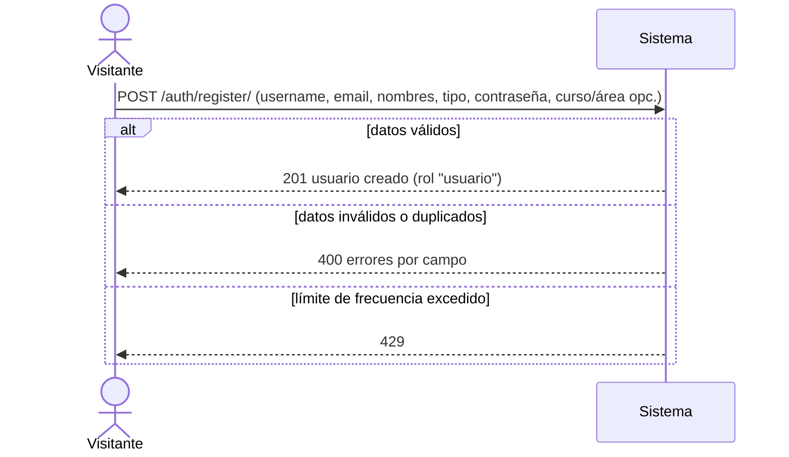
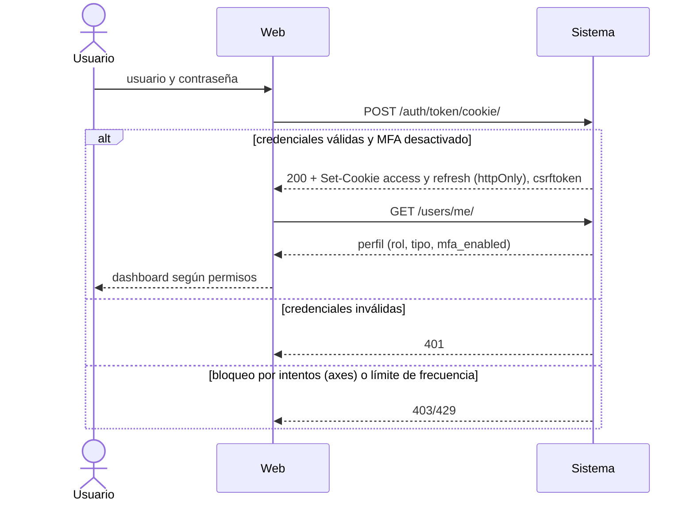
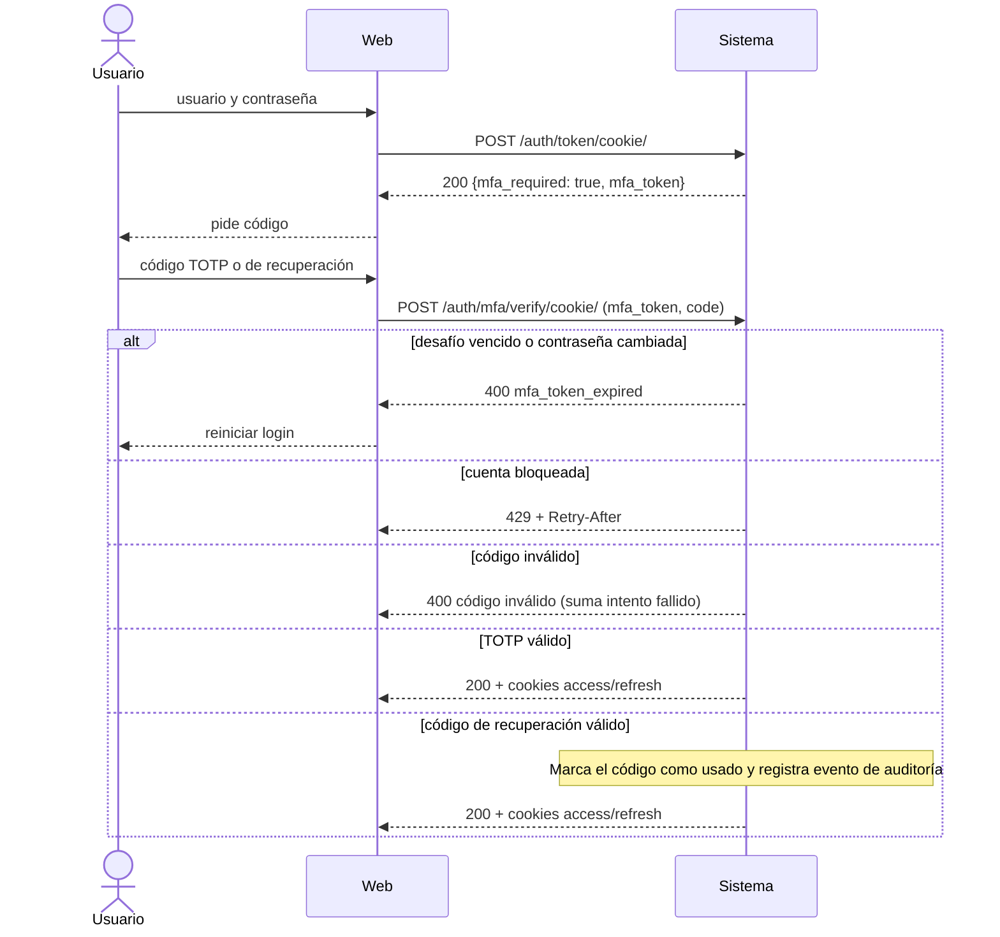
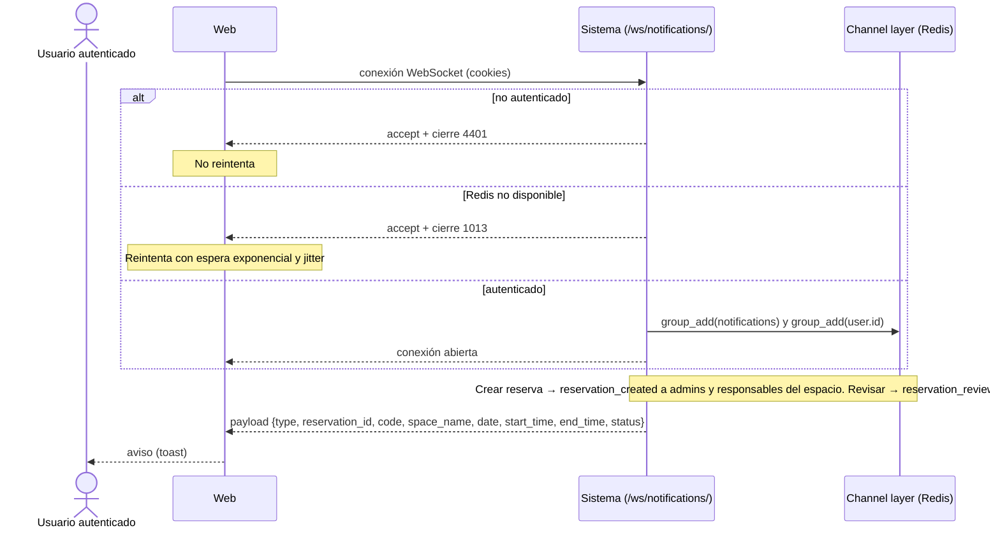
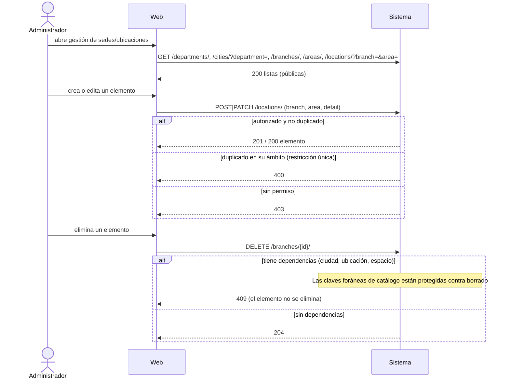

# Diagramas de secuencia del sistema (SSD) de ReservaTrack

> **Documento de análisis inicial (ingeniería inversa, 2026-11-11/13).** La especificación vigente es [specs/003-reservatrack-platform/spec.md](../../specs/003-reservatrack-platform/spec.md); ante cualquier diferencia prevalece la spec 003 y su plan/tareas. Se conserva como referencia histórica.

**Tipo:** diagramas de secuencia del sistema obtenidos por ingeniería inversa
**Complementa a:** [SPEC.md](SPEC.md) (v1.0)
**Fecha:** 11 de noviembre de 2026
**Convención:** cada SSD trata al sistema como caja negra: muestra al actor, los mensajes que envía y las respuestas visibles. Donde el detalle interno cambia el resultado observable (bloqueos, transacciones, cookies), se anota como nota o participante auxiliar. Los diagramas usan sintaxis Mermaid.

Los comportamientos se leen del código: `backend/reservations/api_views.py`, `backend/reservations/api_serializers.py`, `backend/common/views.py`, `backend/common/authentication.py`, `backend/common/permissions.py`, `backend/users/mfa.py`, `backend/users/mfa_views.py`, `backend/users/views.py`, `backend/spaces/api_views.py`, `backend/realtime/consumers.py`. Lo que el código no hace se señala como tal, no se completa por suposición.

## Índice

| Id | Caso de uso | Actor |
| --- | --- | --- |
| SSD-01 | Registrarse | Visitante |
| SSD-02 | Iniciar sesión (sin MFA) | Usuario |
| SSD-03 | Iniciar sesión con MFA | Usuario |
| SSD-04 | Renovar sesión y cerrar sesión | Usuario |
| SSD-05 | Consultar espacios y disponibilidad | Visitante / Usuario |
| SSD-06 | Solicitar una reserva | Estudiante, docente, personal administrativo |
| SSD-07 | Revisar (aprobar o rechazar) una solicitud | Docente responsable / Administrador |
| SSD-08 | Asignar responsable a un espacio | Administrador / Personal administrativo |
| SSD-09 | Activar MFA | Usuario autenticado |
| SSD-10 | Regenerar códigos de recuperación y desactivar MFA | Usuario autenticado |
| SSD-11 | Restablecer MFA de otro usuario | Ingeniero de software |
| SSD-12 | Recibir notificaciones en tiempo real | Usuario autenticado |
| SSD-13 | Administrar catálogos de ubicación | Administrador |
| SSD-14 | Solicitar reserva desde el módulo embebido Timonel | Docente / usuario |
| SSD-15 | Gestionar espacios (alta, edición, baja) | Administrador / personal administrativo |
| SSD-16 | Gestionar usuarios y contraseñas | Ingeniero de software / administrador / usuario |

Participantes comunes: **Actor** (persona), **Web** (SPA React), **API** (Django REST Framework en `/api/v1/`). `Web` aparece solo cuando su comportamiento propio es relevante.

---

## SSD-01 Registrarse

Endpoint público, con límite de frecuencia (`register`). No inicia sesión: devuelve el usuario creado.



---

## SSD-02 Iniciar sesión (sin MFA)

El navegador usa el endpoint `cookie`. Los tokens no llegan al cuerpo: se entregan como cookies `httpOnly`, más la cookie `csrftoken` legible por JS.



Clientes externos usan `POST /auth/token/`, con la misma lógica pero con `access` y `refresh` en el cuerpo.

---

## SSD-03 Iniciar sesión con MFA

La contraseña correcta no emite tokens: emite un desafío firmado (con huella de la contraseña y vida corta) que solo sirve en el segundo paso. El segundo factor es un TOTP o un código de recuperación de un solo uso.



Nota: los fallos se persisten en el dispositivo MFA. Al llegar a `MAX_FAILURES` la cuenta se bloquea `LOCK_MINUTES` minutos. Un paso TOTP ya usado (`last_used_step`) no se acepta de nuevo.

---

## SSD-04 Renovar sesión y cerrar sesión

El interceptor de `api.ts` reintenta una vez tras un 401, con una única renovación compartida. Renovar y cerrar sesión exigen CSRF porque dependen de cookies.

```mermaid
sequenceDiagram
    actor U as Usuario
    participant Web
    participant API as Sistema
    U->>Web: acción protegida
    Web->>API: petición (cookie access)
    API-->>Web: 401 (access vencido)
    Web->>API: POST /auth/token/cookie/refresh/ (cookie refresh + X-CSRFToken)
    alt refresh válido
        API-->>Web: 200 + nuevas cookies
        Web->>API: reintenta la petición original
        API-->>Web: respuesta
    else refresh ausente, inválido o expirado
        API-->>Web: 401 + borra cookies
        Web-->>U: sesión terminada
    end
    U->>Web: cerrar sesión
    Web->>API: POST /auth/token/cookie/logout/ (X-CSRFToken)
    Note over API: Refresh token a la lista negra; cookies eliminadas
    API-->>Web: 204
```

---

## SSD-05 Consultar espacios y disponibilidad

Lectura pública (sin autenticación). Las escrituras sobre espacios sí exigen sesión y permiso.

```mermaid
sequenceDiagram
    actor A as Actor
    participant Web
    participant API as Sistema
    A->>Web: abre /espacios o /disponibilidad
    Web->>API: GET /spaces/?category=&is_active=&search=
    API-->>Web: 200 lista paginada (20 por página)
    opt usuario autenticado
        Web->>API: GET /reservations/?space=&date=
        Note over API: Alcance según rol: admin ve todas; docente las propias y las de sus espacios; el resto, las propias
        API-->>Web: 200 reservas visibles
    end
    Web-->>A: espacios y franjas
```

Limitación observada: un usuario sin rol de administración no ve reservas ajenas, así que la disponibilidad mostrada al consultar `/reservations/` es parcial. El conflicto real se detecta en el servidor al crear (SSD-06).

---

## SSD-06 Solicitar una reserva

Es el flujo con más reglas. El servidor asigna solicitante, código y estado inicial `pending`. La validación de cruces se hace dos veces: en el serializer (respuesta rápida) y de nuevo dentro de una transacción con bloqueo de fila del espacio (garantía frente a concurrencia).

```mermaid
sequenceDiagram
    actor U as Solicitante
    participant Web
    participant API as Sistema
    participant DB as PostgreSQL
    U->>Web: espacio, fecha, hora inicio/fin, datos según tipo
    Web->>API: POST /reservations/ (X-CSRFToken)
    Note over API: Permiso "reservations:create" (estudiante, docente, personal administrativo, admin)
    API->>API: Validar serializer
    Note over API: Espacio activo; aula/otro exige motivo; laboratorio y auditorio exigen asignatura y grupo; auditorio exige asistentes ≤ capacidad; fin > inicio
    API->>DB: ¿hay cruce pendiente/aprobado mismo espacio y fecha?
    alt validación fallida
        API-->>Web: 400 errores por campo
        Web-->>U: muestra errores
    else
        API->>DB: BEGIN; SELECT ... FOR UPDATE (espacio)
        API->>DB: re-verifica espacio activo y cruces
        alt conflicto
            API->>DB: ROLLBACK
            API-->>Web: 400 "El espacio ya tiene una reserva en ese horario."
        else libre
            API->>DB: INSERT reserva (user=solicitante, status=pending, código temporal)
            API->>DB: UPDATE código = RT-AAAA-NNNN (según id)
            API->>DB: COMMIT
            Note over API: Al confirmar, avisa por WebSocket a administradores y responsables activos del espacio (no al solicitante)
            API-->>Web: 201 reserva (status pending)
            Web-->>U: confirmación
        end
    end
```

Observaciones:

- Para laboratorio y auditorio, si el motivo está vacío el servidor lo compone como `asignatura · grupo` (+ `· N asistentes` en auditorio).
- Las reservas `rejected` y `canceled` no bloquean el horario; las `pending` sí.
- Si el backend rechaza la operación con ciertos errores HTTP o de red, `reservaTrack.service.ts` puede guardar la reserva localmente (modo demo, solicitante fijo). Es la discrepancia 1 de SPEC.md §8.

---

## SSD-07 Revisar (aprobar o rechazar) una solicitud

Pueden revisar el administrador/superusuario y los docentes responsables activos del espacio. La transición se hace con bloqueo de fila; una segunda revisión recibe 409.

```mermaid
sequenceDiagram
    actor R as Revisor
    participant Web
    participant API as Sistema
    participant DB as PostgreSQL
    R->>Web: aprobar o rechazar solicitud
    Web->>API: POST /reservations/{id}/approve/ (o /reject/)
    API->>DB: obtiene reserva dentro del alcance visible del revisor
    alt no visible o sin permiso de revisión
        API-->>Web: 404 o 403
    else
        API->>DB: BEGIN; SELECT ... FOR UPDATE (reserva)
        alt status distinto de pending
            API->>DB: ROLLBACK
            API-->>Web: 409 "Solo se pueden revisar solicitudes pendientes."
        else pending
            API->>DB: status=approved|rejected, reviewed_by, response_date
            API->>DB: COMMIT
            Note over API: Al confirmar, avisa por WebSocket solo al solicitante (reservation_reviewed)
            API-->>Web: 200 reserva actualizada
            Web-->>R: estado actualizado
        end
    end
```

Notas:

- Un docente solo revisa si tiene una responsabilidad activa sobre el espacio de la reserva.
- Al aprobar no se revalida el cruce: se confía en que la reserva `pending` ya bloqueó el horario desde su creación.
- La notificación al solicitante viaja por WebSocket (SSD-12). No hay correo.

---

## SSD-08 Asignar responsable a un espacio

Recurso `/responsibilities/`. La combinación usuario/espacio es única, y la relación se puede desactivar con `is_active`.

```mermaid
sequenceDiagram
    actor A as Administrador o personal administrativo
    participant Web
    participant API as Sistema
    A->>Web: elige espacio y usuario responsable
    Web->>API: GET /users/ (usuarios asignables)
    Note over API: Administrador ve todos; personal administrativo solo usuarios activos de rol "usuario"
    API-->>Web: lista de usuarios
    Web->>API: POST /responsibilities/ (space, user)
    Note over API: Permiso "responsibilities:create" (admin o personal administrativo)
    alt autorizado y no duplicado
        API-->>Web: 201 responsabilidad activa
    else duplicado o datos inválidos
        API-->>Web: 400
    else sin permiso
        API-->>Web: 403
    end
```

Reglas de validación (`SpaceResponsibilitySerializer`):

- El usuario asignado debe tener rol `usuario` y estar activo. Un administrador no puede ser responsable.
- Si quien asigna es personal administrativo, debe tener una responsabilidad activa sobre ese mismo espacio. Si no, recibe 400 en el campo `space`: "Solo puedes asignar responsables en tus espacios asignados."
- El administrador y el superusuario no tienen la restricción de espacio.
- La duplicidad usuario/espacio la rechaza la restricción única de base de datos.

---

## SSD-09 Activar MFA

El secreto se guarda cifrado y el dispositivo queda sin confirmar hasta que el usuario demuestra que su app genera códigos válidos.

```mermaid
sequenceDiagram
    actor U as Usuario autenticado
    participant Web
    participant API as Sistema
    U->>Web: /seguridad → activar
    Web->>API: GET /auth/mfa/status/
    API-->>Web: {enabled: false, recovery_codes_remaining: 0}
    Web->>API: POST /auth/mfa/setup/
    alt MFA ya activo
        API-->>Web: 409
    else
        Note over API: Genera secreto, lo cifra y crea dispositivo sin confirmar
        API-->>Web: 200 {qr, secret, otpauth_uri}
        Web-->>U: muestra QR y secreto manual
    end
    U->>Web: código de 6 dígitos de su app
    Web->>API: POST /auth/mfa/confirm/ (code)
    alt código válido
        Note over API: Dispositivo confirmado; emite códigos de recuperación (solo se guardan sus HMAC); auditoría "mfa: enabled"
        API-->>Web: 200 {recovery_codes}
        Web-->>U: muestra los códigos una vez
    else inválido
        API-->>Web: 400 código inválido
    end
```

---

## SSD-10 Regenerar códigos de recuperación y desactivar MFA

Ambas acciones exigen un segundo factor vigente. Regenerar acepta solo TOTP, porque un código de recuperación no puede generar otros. Desactivar exige además la contraseña.

```mermaid
sequenceDiagram
    actor U as Usuario autenticado
    participant Web
    participant API as Sistema
    U->>Web: regenerar códigos
    Web->>API: POST /auth/mfa/recovery-codes/ (code)
    alt MFA inactivo
        API-->>Web: 409
    else bloqueado
        API-->>Web: 429
    else TOTP inválido
        API-->>Web: 400
    else TOTP válido
        Note over API: Invalida los anteriores; auditoría "recovery_codes_regenerated"
        API-->>Web: 200 {recovery_codes}
    end
    U->>Web: desactivar MFA
    Web->>API: POST /auth/mfa/disable/ (password, code)
    alt contraseña incorrecta
        API-->>Web: 400
    else MFA ya inactivo
        API-->>Web: 204
    else código bloqueado o inválido
        API-->>Web: 429 o 400
    else todo correcto
        Note over API: Elimina dispositivo y códigos; auditoría "mfa: disabled"
        API-->>Web: 204
    end
```

---

## SSD-11 Restablecer MFA de otro usuario

Recuperación de cuenta cuando el usuario perdió el dispositivo y sus códigos. Solo el ingeniero de software (`IsSoftwareEngineer`) puede hacerlo.

```mermaid
sequenceDiagram
    actor E as Ingeniero de software
    participant API as Sistema
    E->>API: POST /users/{id}/reset_mfa/
    alt sin permiso
        API-->>E: 403
    else
        Note over API: Elimina dispositivo MFA y códigos del usuario; auditoría "mfa: reset_by_admin"
        API-->>E: 204
    end
    Note over E,API: El usuario afectado vuelve a iniciar sesión sin MFA y puede enrolarse otra vez (SSD-09)
```

---

## SSD-12 Recibir notificaciones en tiempo real

El canal es de servidor a cliente: lo que el cliente envíe se ignora. Cada conexión autenticada se une al grupo global `notifications` (sin productores hoy) y a un grupo privado `user.<id>`. Los eventos de reservas van solo al grupo privado de los implicados y se publican al confirmarse la transacción.



Si el channel layer falla, la publicación se registra en el log y la operación de negocio continúa.

---

## SSD-13 Administrar catálogos de ubicación

Departamento → ciudad → sede (`branches`), áreas y ubicaciones puntuales (sede + área + detalle). Los cinco recursos comparten el permiso `branches`: lectura pública, escritura solo para administrador o superusuario. Los demás actores, incluido el personal administrativo, no tienen permiso de escritura sobre catálogos.



Antes respondía 500 (`ProtectedError` sin capturar). Se corrigió con `ProtectedDeleteMixin` en `branches/api_views.py`: ahora responde 409 y el elemento se conserva (`test_delete_department_with_cities_returns_409`).

---

## SSD-14 Solicitar reserva desde el módulo embebido Timonel

`/timonel/reservas` es la misma página de reservas (`ReservationsPage` con `timonelModule`), sin la navegación principal. Nginx permite incrustarla en un `iframe` solo desde los orígenes de `TIMONEL_ALLOWED_ORIGINS` (`frame-ancestors`). No hay SSO: el usuario necesita una sesión de ReservaTrack en el navegador.

```mermaid
sequenceDiagram
    actor D as Docente / usuario
    participant T as Timonel (página anfitriona)
    participant Web as ReservaTrack (iframe)
    participant API as Sistema
    D->>T: abre el módulo de reservas
    T->>Web: carga /timonel/reservas (frame-ancestors permitido)
    Web->>API: GET /reservations/ y GET /spaces/
    alt sesión válida (cookie)
        API-->>Web: reservas visibles y espacios
        Note over Web: Filtra a aulas, laboratorios y auditorios activos; oculta aprobar/rechazar (canReview = false)
        Web-->>D: formulario "Solicitar espacio"
        D->>Web: completa la solicitud
        Web->>API: POST /reservations/
        Note over API: Mismo flujo y reglas que SSD-06
        API-->>Web: 201 pending / 400
    else sin sesión
        API-->>Web: 401 (o lista vacía en lectura pública)
        Note over Web: Puede caer al modo demo con datos locales
    end
```

Notas:

- Ocultar la revisión en el módulo es una decisión de interfaz: el servidor sigue permitiendo revisar a quien tenga permiso (SSD-07).
- Si `TIMONEL_ALLOWED_ORIGINS` está vacío, la cabecera queda `frame-ancestors 'self' ;` y solo se puede incrustar desde el propio origen.
- Cookies de terceros: con `SameSite` estricto/lax, el navegador puede no enviar las cookies dentro del iframe desde otro dominio. El valor por defecto de `AUTH_COOKIE_SAMESITE` es `Lax` (`config/settings/base.py`), así que desde un dominio distinto de ReservaTrack las cookies no viajan en el iframe a menos que el despliegue lo cambie a `None` (con `Secure`).

---

## SSD-15 Gestionar espacios (alta, edición, baja)

Lectura pública (SSD-05). Las escrituras exigen sesión y el permiso `spaces`: el administrador crea, edita y elimina; el personal administrativo solo edita, y solo los espacios donde tiene una responsabilidad activa (comprobado a nivel de objeto).

```mermaid
sequenceDiagram
    actor A as Administrador / personal administrativo
    participant Web
    participant API as Sistema
    A->>Web: datos del espacio (nombre, categoría, capacidad, ubicación o place)
    alt alta
        Web->>API: POST /spaces/
        Note over API: Permiso spaces:create (solo administrador)
    else edición
        Web->>API: PATCH /spaces/{id}/
        Note over API: Permiso spaces:edit; si es personal administrativo, exige responsabilidad activa sobre ese espacio
    end
    API->>API: Validar
    Note over API: capacidad ≥ 1; exige texto de ubicación o place del catálogo; si hay place y no hay texto, el servidor copia la ubicación normalizada (máx. 200)
    alt válido y autorizado
        API-->>Web: 201 / 200 espacio (con responsible_names)
    else inválido
        API-->>Web: 400 errores por campo
    else sin permiso
        API-->>Web: 403
    end
    A->>Web: eliminar espacio
    Web->>API: DELETE /spaces/{id}/
    alt administrador
        Note over API: Borra el espacio; sus reservas y responsabilidades se eliminan en cascada
        API-->>Web: 204
    else otro rol
        API-->>Web: 403
    end
```

Observaciones:

- **Borrado en cascada:** eliminar un espacio borra todas sus reservas, incluidas las aprobadas, y sus responsabilidades. No hay confirmación del lado servidor ni desactivación previa obligatoria. Desactivar (`is_active=false`) es la vía no destructiva: bloquea nuevas reservas (SSD-06) pero conserva las existentes.
- **Desactivar no cancela:** las reservas pendientes o aprobadas de un espacio desactivado siguen vigentes.
- La edición de `capacity` no revalida reservas de auditorio existentes con más asistentes que la nueva capacidad.

---

## SSD-16 Gestionar usuarios y contraseñas

Cuatro actores con facultades distintas en `UserViewSet`.

| Acción | Quién puede |
| --- | --- |
| Crear (`POST /users/`), eliminar, restablecer MFA | Solo superusuario (ingeniero de software) |
| Listar usuarios | Administrador y superusuario: todos. Personal administrativo: solo usuarios activos de rol `usuario` |
| Ver, editar, cambiar contraseña | Administrador, superusuario, o el propio usuario sobre sí mismo |
| Asignar o retirar el rol `admin` | Solo superusuario |

```mermaid
sequenceDiagram
    actor S as Ingeniero de software
    actor A as Administrador
    actor U as Usuario
    participant API as Sistema
    S->>API: POST /users/ (username, email, nombres, role, contraseña)
    alt datos válidos
        Note over API: Normaliza username/email; rechaza duplicados sin distinguir mayúsculas; valida contraseña con las reglas de Django
        API-->>S: 201 usuario
    else inválido o rol admin pedido por no superusuario
        API-->>S: 400
    end
    A->>API: PATCH /users/{id}/ (role, is_active, datos)
    alt cambia el rol admin (asignar o retirar)
        API-->>A: 400 "Solo el ingeniero de software puede asignar o retirar el rol administrador."
    else cambio permitido
        Note over API: Registra en auditoría solo los cambios de role e is_active (de → a)
        API-->>A: 200 usuario
    end
    U->>API: PATCH /users/{su id}/ (nombre, correo, ...)
    alt incluye role, is_active, is_staff o is_superuser
        API-->>U: 403 "No puedes modificar tu propio rol o estado."
    else solo datos personales
        API-->>U: 200
    end
    U->>API: POST /users/{su id}/set_password/ (current_password, new_password)
    alt falta o es incorrecta la contraseña actual
        API-->>U: 400
    else nueva contraseña incumple reglas de Django
        API-->>U: 400
    else correcta
        Note over API: Guarda el hash; revoca los demás refresh tokens (conserva el de la sesión actual); auditoría "password: changed"
        API-->>U: 204
    end
    A->>API: POST /users/{otro id}/set_password/ (new_password)
    Note over API: Un administrador no necesita la contraseña actual del otro usuario
    API-->>A: 204
    S->>API: DELETE /users/{id}/
    alt es su propia cuenta
        API-->>S: 409 "No puedes eliminar tu propia cuenta."
    else otra cuenta
        Note over API: Auditoría DELETE; las reservas y responsabilidades del usuario se eliminan en cascada
        API-->>S: 204
    end
```

Observaciones:

- **Tipo obligatorio al crear:** `UserCreateSerializer` ahora incluye `type` y lo exige (400 si falta). Antes la cuenta quedaba con tipo vacío y no podía reservar. `UserUpdateSerializer` sigue sin exponer `type`, así que una cuenta ya creada no se corrige por la API.
- **Contradicción con SPEC.md §2:** la spec dice que el administrador puede "consultar y modificar usuarios". Es cierto para ver y editar, pero crear y eliminar son exclusivos del superusuario.
- **Cambiar la contraseña cierra las demás sesiones:** todos los refresh tokens vigentes del usuario pasan a la lista negra. Si el usuario cambia su propia contraseña con una cookie de refresh válida, esa sesión se conserva. Un access token ya emitido sigue valiendo hasta que expire (60 min por defecto). El restablecimiento por un administrador revoca todas las sesiones del usuario.
- **Eliminar usuario en cascada:** borra también sus solicitudes, incluidas las aprobadas.

---

## Hallazgos de esta pasada

1. **Notificaciones sin productores** (SSD-12): se detectó que ningún flujo de reservas publicaba eventos (SPEC.md §8.6). **Corregido:** crear y revisar publican `reservation_created` y `reservation_reviewed` a los implicados.
2. **Doble verificación de cruces** (SSD-06): se hace en el serializer y otra vez dentro de la transacción. Es correcto para concurrencia, pero la primera pasada ocurre fuera del bloqueo y puede dar un falso "libre" que la segunda corrige.
3. **Código de reserva en dos escrituras** (SSD-06): se inserta con un código temporal aleatorio y se actualiza al definitivo `RT-AAAA-NNNN` dentro de la misma transacción. El número sale de la clave primaria, no de un contador anual, y el año es el de creación.
4. **Aprobar no revalida disponibilidad** (SSD-07): es coherente porque `pending` ya bloquea. Una edición posterior del horario sí vuelve a validar (`perform_update`).
5. **Visibilidad parcial de disponibilidad** (SSD-05): quien no es administrador ni docente responsable no ve las reservas ajenas; la UI no puede pintar ocupación completa con esa fuente.
6. **Cancelación sin flujo** (SPEC.md §8.3): ningún SSD puede dibujarse porque no hay acción para ello. Un usuario podría llegar a `canceled` solo editando el estado, que es de solo lectura en el serializer, así que hoy no es alcanzable.

## Correcciones y pruebas

Tras detectar cuatro comportamientos con pruebas, se corrigieron. [backend/common/tests/test_ssd_behaviors.py](backend/common/tests/test_ssd_behaviors.py) los fija (`python -m pytest` en el contenedor `web`: suite completa, 66 pasan).

| Antes | Ahora | Prueba |
| --- | --- | --- |
| Borrar catálogo con dependencias → 500 | 409, el elemento se conserva (`ProtectedDeleteMixin`, `branches/api_views.py`) | `test_delete_department_with_cities_returns_409` |
| `POST /users/` sin tipo → cuenta con tipo vacío | `type` obligatorio (400 si falta) | `test_create_user_requires_type`, `test_user_created_with_type_can_reserve` |
| Cambio de contraseña no revocaba sesiones | Revoca los demás refresh tokens; conserva el actual si es el propio usuario | `test_password_change_revokes_other_sessions_and_keeps_current`, `test_admin_password_reset_revokes_all_sessions_of_target` |
| Crear/revisar reservas no publicaba eventos | Eventos por grupo privado `user.<id>` (`reservations/notifications.py`, `realtime/events.py`) | `test_create_notifies_admins_and_space_responsibles_not_requester`, `test_review_notifies_only_the_requester` |

El frontend interpreta los dos eventos nuevos (`src/types/notify/notifications.ts`, `src/context/NotificationContext.tsx`).

## Pendiente

- Confirmar el valor de `AUTH_COOKIE_SAMESITE` en cada despliegue si Timonel está en otro dominio (SSD-14).
- Probar el flujo de avisos con un WebSocket real y dos navegadores (las pruebas usan un channel layer simulado).
- Responsabilidades: edición y desactivación (`PATCH` con `is_active`) y baja, que siguen el patrón de SSD-08 y no tienen diagrama propio.
